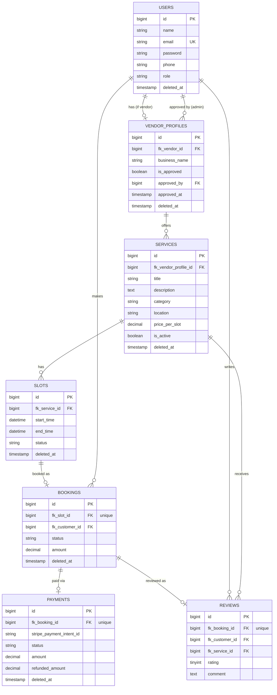

# Database ERD of Multi-Vendor Booking Platform

## How to read this

- `||--o{` means "one to many", one `VENDOR_PROFILES` row can have many `SERVICES` rows.
- `||--o|` means "one to one", one `BOOKINGS` row has exactly one `PAYMENTS` row.
- `FK "unique"` on a foreign key means that column also has a unique constraint, this is what makes `slot_id` on `bookings` guarantee one slot can never have two bookings.

## Relationship summary

- **users → vendor_profiles**: one-to-one. Only users with `role = vendor` have a row here.
- **vendor_profiles → services**: one-to-many. One vendor can list many venues/services.
- **services → slots**: one-to-many. One listing has many bookable time slots.
- **slots → bookings**: one-to-one. Enforced by a unique constraint on `slot_id`, this is the database-level safety net against double-booking.
- **users → bookings**: one-to-many. A customer can have many bookings.
- **bookings → payments**: one-to-one. Each booking has exactly one payment record.
- **bookings → reviews**: one-to-one. You can only review a booking you actually made, once.
- **users → vendor_profiles (approved_by)**: a second relationship from `users`, representing which admin approved a given vendor.

## Why this is normalized

No table stores data that belongs to another table. `bookings.amount` is the one intentional exception, it's a price snapshot at time of booking, not a normalization mistake, since the live price lives in `services.price_per_slot` and can change independently.
